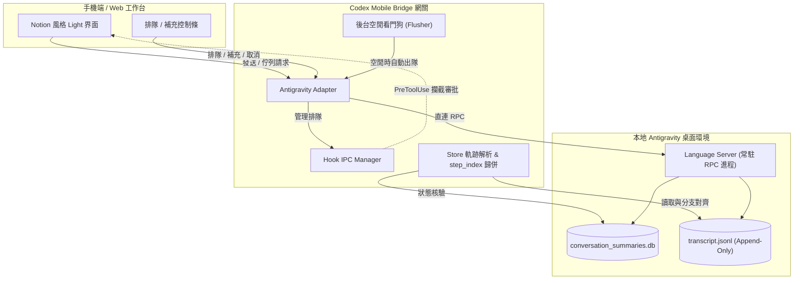
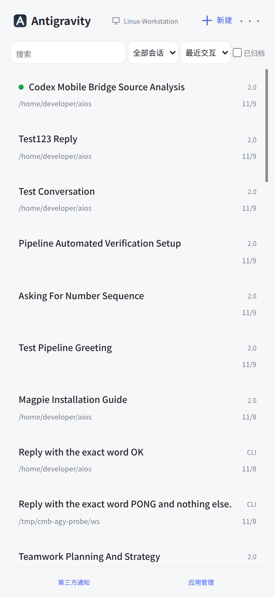
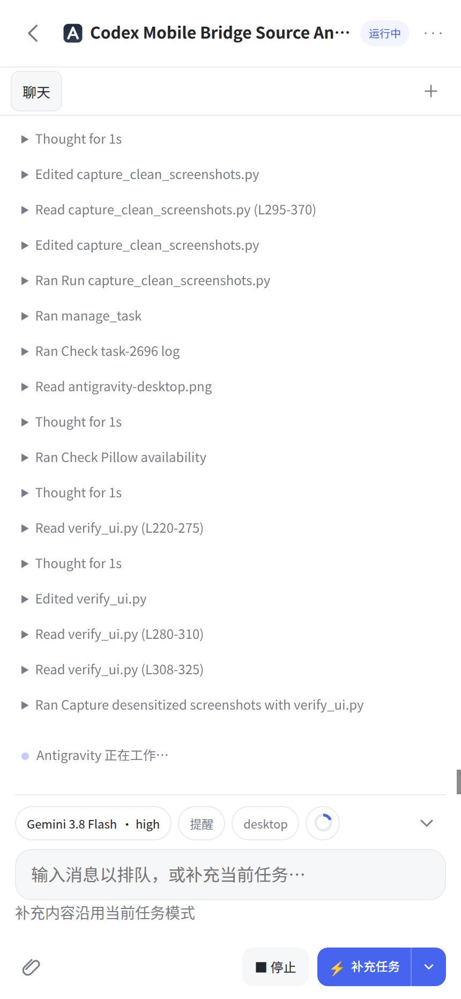

# Google Antigravity 2.0 / IDE 桌面端接入指南

本模組為 Codex Mobile Bridge 提供對 Google Antigravity 桌面端（涵蓋獨立桌面 App、Antigravity IDE 以及 CLI 核心）的原生遠程控制與多端協同支援。使用者可透過手機 App 或瀏覽器工作台，無縫接續電腦上的 Antigravity 會話、切換模型與推理思考強度、進行任務排隊與補充、以及即時處理危險工具調用的審批授權。

---

## 一、設計哲學：單一寫入權原則（Single Writer Principle）

在多端串接 Agent 系統時，最嚴重的瓶頸是「狀態分叉（Split-Brain）」——若手機端與電腦端各自拉起獨立程序寫入同一個對話，會導致對話歷史相互覆蓋、記憶體狀態脫節或上下文丟失。

本接入方案實施嚴格的 **Single Writer 原則**：
1. **廢棄臨時進程寫入**：嚴禁在桌面端存活時額外 fork 臨時獨立 CLI 進程去改寫磁碟日誌。
2. **原生 Language Server RPC 直連**：
   - 探測並直連 Antigravity 桌面進程常駐的 Language Server（支援自動端口探測、進程健康檢查與 CSRF 握手）。
   - 所有的對話創建、訊息發送、任務取消均透過原生 RPC 調用（`StartCascade`、`SendUserCascadeMessage`、`CancelCascadeInvocation`）注入運行中的核心進程。
   - 保證電腦端 UI、內存記憶體與磁碟日誌 100% 同步，實現跨端交替發送時歷史紀錄即時無感對齊。

---

## 二、核心架構與技術特點



### 1. 多表面（Surfaces）與專案自動探測
Antigravity 具備多種運行形態。網關支援跨目錄自動掃描並聚合展示：
- **桌面獨立版 (App)**：`~/.gemini/antigravity`
- **IDE 整合版 (IDE)**：`~/.gemini/antigravity-ide`
- **命令列核心 (CLI)**：`~/.antigravity`

所有會話自動提取所屬專案目錄（Workspace URI）、標題、最後更新時間與巢狀子任務（Subagent Tasks），無需手動匯入。

### 2. 模型與思考強度全鏈路同步
- **模型目錄動態枚舉**：支援包括 `Gemini 3.8 Flash`、`Gemini 4 Argon`、`Claude Sonnet 5.5` 等官方模型目錄。
- **思考強度（Effort）精確對齊**：支援 `low`、`medium`、`high` 三檔思考強度配置，在新建會話或切換設定時精確封裝進 `cascade_config.planner_config.requested_model`，確保桌面端與手機端推理配置完全一致。

### 3. 軌跡歸併與分支對齊（Reconciliation）
Antigravity 的日誌採用 Append-only 的 `transcript.jsonl`。當發生重新生成或多端併發時，日誌中可能出現多個相同的 `step_index`。
- **主幹覆寫演算法**：網關在解析會話軌跡時，依據日誌時間戳與 `step_index` 建立歸併機制，後續新寫入的分支步驟會精確覆蓋舊的被廢棄步驟，避免舊分支殘留步驟在介面上無腦堆疊。

### 4. 佇列排隊 (`queue`) 與任務補充 (`steer`) 自動直發
手機端提供兩種追問模式：
- **排隊發送 (`queue`)**：等待當前 Agent 任務全部完成後再行發送。
- **立即補充 (`steer`)**：在當前執行的步驟完成後立即介入補充指令。

**雙重自動出隊機制**：
1. **中途 Hook 注入**：當 Agent 正在調用多步驟工具時，若有 `steer` 訊息，會在外掛回調中作為 `injectSteps` 即時注入對話。
2. **空閒看門狗直發 (`_flush_idle_queue`)**：
   - 當 Agent 回覆純文字對話（無工具調用）或任務結束回到空閒狀態時，Bridge 的獨立後台守護線程（每 1.5 秒循環）與手機端 `detail` 輪詢會即時檢測空閒標誌（`not_fully_idle == 0`）。
   - 自動將佇列隊首的訊息經由 RPC 送入核心，並設置 2 秒防抖以確保核心狀態完全轉換，徹底解決傳統外掛在無工具調用時排隊訊息滯留卡死的問題。
3. **靈活管理**：排隊列表支援一鍵轉換模式（排隊 ⇄ 補充）、就地編輯內容或取消發送。

### 5. 工具安全審批流程
針對敏感或危險工具（如終端指令執行、檔案覆寫）：
- **桌面端處理 (`desktop`)**：預設模式，由電腦桌面端原生彈窗處理，不阻礙桌面操作。
- **手機端審批 (`mobile-ask`)**：透過 Hook 攔截危險操作並推送至手機工作台，待手機端點擊「允許」或「拒絕」後放行。
- **自動允許 (`auto-allow`)**：適用於無人值守測試場景，自動授權所有攔截範圍內的工具調用。

### 6. 發送防重與併發互斥
- 實裝基於 `(conversation_id, prompt_hash)` 的 In-flight 互斥鎖，同一會話同一時間僅允許一個寫入操作進行。
- 移除不可預測的超時重試機制，保證寫入操作的完全冪等，杜絕短時間內相同訊息被重複觸發寫入的情況。

---

## 三、介面與視覺體驗

- **堅持 Light（淺色/白底）模式**：全面適配高對比、低飽和度的 Notion 極簡幾何卡片風格，拒絕突兀暗色與擁擠排版。
- **實讀與推測透明標記**：模型即時思考折疊展現（`Thought for Xs`）、工具調用過程清晰標註，確保上下文閱讀體驗流暢。
- **底部安全留白**：底部常駐輸入框與排隊欄均具備防遮擋 Padding 與即時滾動鎖定，保障單手操作時的流暢體驗。

<p align="center">
  
  &nbsp;&nbsp;
  
</p>

---

## 四、安全與脫敏規範

在配置與部署本網關時，請遵循以下安全指引：
1. **隱私脫敏**：網關對外廣播與日誌記錄中，已對本機敏感環境變數、私人憑證與公務路徑進行脫敏處理；在遠程訪問日誌中僅顯示回環位址或脫敏後的標籤。
2. **認證防君子設計**：會話存取基於 Gateway ID 與原生 UUID 雙層校驗，未經授權的請求無法直接透過窮舉目錄枚舉其他會話。
3. **斷網保護**：電腦休眠或網路中斷時，排隊發送操作安全保存在本地佇列快取中，不會造成資料丟失或幽靈任務。

---

## 五、驗證與測試

本接入模組配備完整的自動化回歸測試套件（`tests/test_antigravity_adapter.py`），包含：
- **會話目錄與多表面掃描測試**
- **模型與思考強度解析測試**
- **`step_index` 分支覆寫歸併測試**
- **Hook IPC 審批與跨進程通訊測試**
- **佇列切換、編輯、取消操作測試**
- **空閒看門狗自動出隊與防抖測試**
- **架構模組邊界完整性檢查 (`scripts/check-boundaries.py`)**

所有測試均可在純淨的 Linux / macOS 環境下以標準指令重現：
```bash
python3 scripts/check-boundaries.py
PYTHONPATH=. python3 tests/test_antigravity_adapter.py -v
```
