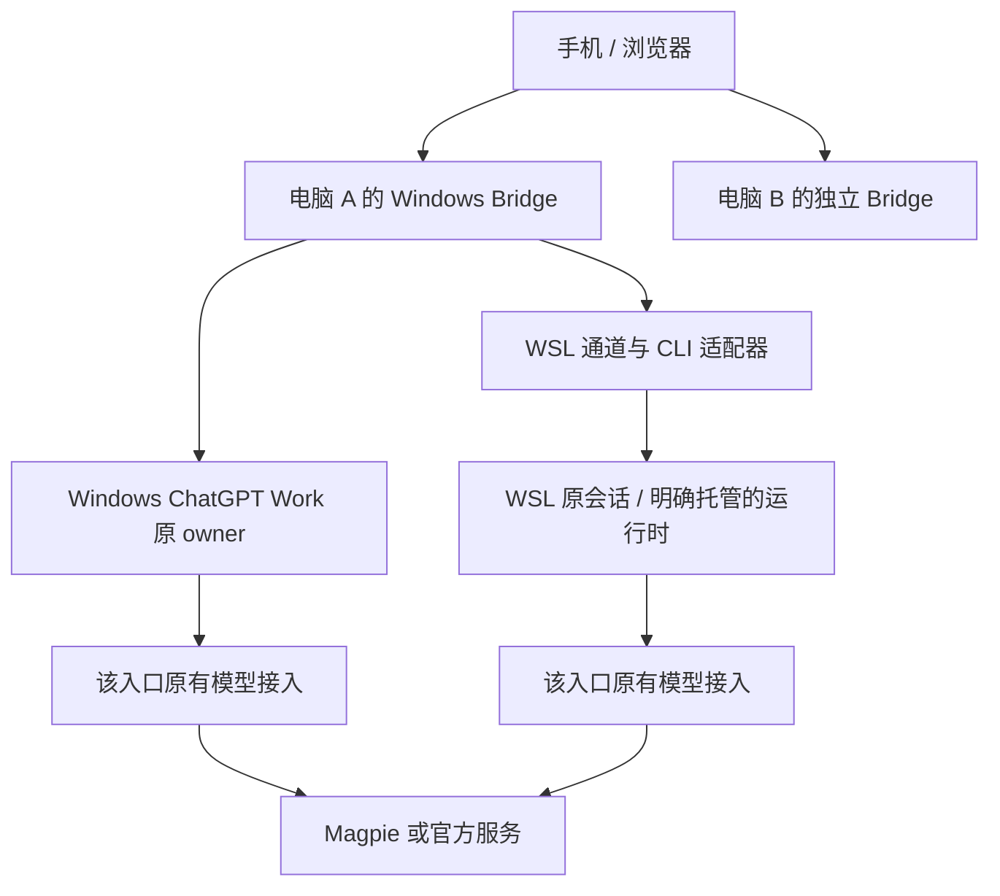

# Windows ChatGPT、WSL CLI 与多电脑接入规划

状态：初始设计提案。本机 Windows / WSL 与 Magpie 已开展实现，当前能力和边界见 [使用说明](../wsl-codex.md)及[验证记录](windows-wsl-validation.md)；其他电脑暂缓。
日期：2026-10-16。

## 目标与已确认场景

用户目前在 Windows 使用 ChatGPT 桌面软件内的 Codex/Work，同时在 WSL 终端使用 Codex CLI；模型接入由 Magpie 管理。后续还会增加其他电脑上的 Codex。

目标是在同一套 Bridge 界面中明确选择电脑与入口，保留各入口原有的会话、认证、提供商、工作目录和执行归属。模型流量继续沿原有 Codex → Magpie → 上游的路径发送。

本提案不假定两个入口共用配置，不要求合并 Windows 和 WSL 的 `.codex`，也不把读取历史视为获得执行权限。

## 当前代码与差距

| 已有实现 | 对本场景的影响 |
| --- | --- |
| `bridge/clients/discovery.py` 按客户端种类发现一份 Codex 数据目录与桌面程序 | 不能完整表达同一电脑上的多个 Codex 环境和运行入口 |
| `bridge/features/sessions/store.py` 筛选 `Codex Desktop`、`codex_work_desktop` 等桌面来源 | 普通 CLI 会话需要独立的来源识别与列表策略，不能简单取消全部过滤 |
| `bridge/app/service.py` 以本机 Bridge 与桌面记录的 SSH host 组织会话 | 需要在现有原生 host 之外补充入口身份；原生 `hostId` 的协议含义必须保留 |
| `bridge/clients/codex/remote.py` 从 App 元数据取得 SSH 项目，发送仍依赖桌面 IPC owner | 这是桌面管理的远端工作区，不等同于另一台电脑或 WSL 内独立运行的 CLI |
| `bridge/features/accounts/accounts.py` 面向一份本机配置切换认证和默认提供商 | 需要按配置实际共享范围隔离，防止与 Magpie 同时管理相同字段 |
| `bridge/clients/codex/catalog.py` 已读取有效提供商配置，再查询模型 | 可复用，但需核对 Magpie 模型目录、组合接入模式与各环境中的凭据来源 |
| 已有网络连接与手机入口管理 | 多电脑先复用独立网关连接，不必首先引入中心服务 |

以上基于本次源码阅读。尚未检查用户实际安装版本、个人配置、WSL 网络模式或正在运行的会话。

## 建议的身份与路由模型

区分四个概念：

| 概念 | 示例 | 身份规则 |
| --- | --- | --- |
| 电脑/网关 | 办公台式机、笔记本 | 配对绑定的稳定身份；地址、显示名称和临时端口不是身份 |
| 执行环境 | Windows 用户环境、WSL Ubuntu 用户环境、独立 SSH 环境 | 记录操作系统、用户、发行版或主机绑定；路径始终在对应环境解释 |
| Codex 入口 | Windows ChatGPT Work、WSL CLI、以后新增的独立 CLI 配置 | 持久化 `endpointId`，绑定已核验运行时、配置目录和支持能力 |
| 模型接入 | 官方、Magpie、Bridge 管理的 API | 独立于 Codex 入口；一个入口可按其真实配置使用不同接入 |

配置增加版本号和入口注册表。旧的单入口配置显式迁移为默认本机桌面入口，保留现有配对、历史和默认选择。

应用内的会话引用增加电脑与入口范围，并保留原生 `hostId + conversationId + ownerClientId`。HTTP 请求只提交已注册入口 ID，服务端解析真实路径与运行程序，不接受手机传入任意主机、发行版、配置目录或可执行文件。

同一个原生会话可能被多个视图发现：按真实会话存储/运行归属建立统一绑定，不因入口显示不同而允许两个执行器同时控制同一线程。电脑复制或配置克隆后须重新绑定设备身份，不能只凭相同线程 UUID 合并会话。

草稿、附件、项目键、目录缓存、通知游标、操作回执和待确认发送都增加入口范围。模型与账号缓存再区分配置版本和 provider；认证变化时作废旧缓存。通知对同一原生会话去重。

## 推荐部署方式

第一阶段一台电脑保留一个 Windows 网关，由它管理 Windows 入口及已登记的 WSL 入口。WSL 先使用受限子进程通道，避免要求用户另外部署公网服务。若后续 CLI 持续连接必须使用常驻连接器，再独立设计其生命周期与本机认证。

其他电脑各运行自己的网关，手机保存多个配对连接并切换。优先做到可靠切换；跨电脑合并列表作为后续功能，按设备分别取数与授权，不能由一个网关拿手机 Cookie 去访问另一网关。

现有桌面 SSH 项目保持其原生 host 与 owner，不自动登记成独立网关。历史共享中继文档含已归档功能，本方案不以恢复该入口为前置条件。

## WSL 接入与 CLI 执行边界

### WSL 通道

- Windows 平台层负责发行版状态、进程与原生通道；共享业务仍在 features，Codex 数据和协议仍在 clients。
- 默认只枚举发行版状态；不因轮询、列表或通知启动已停止的 WSL 发行版。
- 用户明确添加/连接后，在选定发行版和用户环境内核验 Codex 版本、配置目录与程序路径。独立保存各发行版、用户和自定义 `CODEX_HOME`。
- 不将 `C:\...`、`/home/...` 或 UNC 路径直接混用；文件、终端和上传下载仍在目标环境校验工作区边界。
- 受限命令使用参数数组和固定协议。手机不提供任意 shell 命令，日志和诊断不输出凭据。
- WSL 停止、休眠或重启后旧连接失效；重新验证身份后恢复只读连接，写入结果未知不重放。

### 三种 CLI 能力分别交付

| 会话形态 | 规划行为 |
| --- | --- |
| 已存在的普通 CLI 会话历史 | 可独立展示历史和来源；不要求存在桌面 owner |
| 正在终端运行的普通 CLI 会话 | 先验证该安装版本有无可绑定原执行器的受支持通道；未验证前标为仅查看，禁止发送、审批和停止 |
| 用户明确选择由 Bridge 托管的 CLI 会话 | 可新增受限 app-server 适配器，由同一运行时提供持续状态、发送和审批；不走桌面深链接激活 |

官方 app-server 文档提供 `thread/read`、`thread/resume`、`turn/start` 等接口，但没有据此证明“新启动一个 app-server 就能附着到任意正在运行的 TUI”。因此不能靠另起进程恢复同一 UUID，声称接管原终端会话。

若原 CLI 没有可靠的共享控制通道，完整手机控制需采用明确托管的启动方式。继续已有线程前必须确认原执行器已释放、原会话设置能准确恢复；无法核验时维持只读。Bridge 自有租约只能协调参与的 Bridge 进程，不能证明未参与的普通 CLI 已停止。

第一阶段不以屏幕文本或终端按键模拟实现结构化审批。未支持的 Goal、计划模式、权限选项等能力在入口能力表中明确禁用，不伪装桌面功能已等价可用。

## Magpie 共存策略

### 配置管理权

建议每个实际配置目录明确选择管理模式：

- **外部管理（本场景默认）**：Magpie 管理提供商、认证相关接入配置和模型目录；Bridge 读取有效接入，控制具备能力的会话。
- **Bridge 管理**：保留现有账号切换，按该目录实际影响的所有入口核验任务、进程与配置后执行。

管理模式不是安全授权来源。即使标为 Bridge 管理，写入前仍要检查配置是否被 Magpie 或用户修改；同一目录或别名路径必须识别为共享写入范围，不能仅按 endpointId 加锁。

外部管理模式下不自动导入为 `bridge_api`，不清理 Magpie provider，也不替换 `auth.json`、`openai_base_url` 或模型目录引用。模型选择若原 owner 支持会话级设置，可明确应用到当前会话；否则提示在 Magpie 修改，并按实际版本提示是否需要重启。

从外部管理切换为 Bridge 管理是独立操作，需展示影响的配置和入口，检查所有共享配置使用者。发现并发修改就终止，失败恢复不得用旧快照覆盖 Magpie 新写入的内容。

### 模型与状态识别

- 同时核对 `[model_providers.magpie]` 和 `openai_base_url` 等有效配置路径，不仅根据 `model_provider == magpie` 判断。
- 保留 Magpie 模型 ID、路由组 ID 与模型目录语义。优先验证原生运行时目录接口能否正确提供其模型，不强制改为 Bridge 的普通 API 导入流程。
- 模型查询在入口所在环境执行；Windows Bridge 的环境变量不代表 WSL CLI 能取得的凭据。
- 配置文件只代表配置状态，不能据此断言已运行的 CLI 已热更新。区分已配置接入、原 owner 报告的当前设置与实际可验证的连接状态。
- 路由组实际后端可能变化。没有可靠响应元数据时仅展示请求的模型/路由组，不猜测最终上游账号或模型，不显示成官方账号额度。
- Magpie 断开或返回错误时显示明确原因；Bridge 不自动切回官方、不自行换模型、不重放未知结果请求。

### Windows 与 WSL 网络

先诊断 Magpie 实际运行位置、地址以及 WSL NAT/镜像网络。分别从 Windows 和 WSL 验证配置的地址，不能假设两边 `127.0.0.1` 是同一个服务。

只读诊断可检查有效配置、连通性和模型目录，不发送模型任务。涉及跨环境非回环访问时，沿用项目原有 HTTPS、凭据与重定向规则；若现有 Magpie 配置不满足要求，给出需要用户调整的具体原因，不为兼容放宽校验或自动开放监听。

第一版兼容目标是“既有 Magpie 配置继续正常工作”。在手机内直接操作 Magpie 管理界面、同步上游密钥、修改路由组不属于前置需求。

## 分阶段实施

| 阶段 | 主要交付 | 完成标准 |
| --- | --- | --- |
| 0：现场只读核验 | Windows ChatGPT 版本与原生接入、已运行 WSL 中 CLI 的来源/owner、Magpie 配置模式与网络诊断 | 得到不含凭据的能力清单；确认 CLI 控制通道可行性，不启动模型任务 |
| 1：入口身份与隔离 | 入口注册表、旧配置迁移、路由和缓存/草稿/回执隔离 | 保留现有桌面操作；不同入口同名项目、相同线程 UUID 不串写；共享原生会话不重复控制 |
| 2：WSL 只读 + Magpie 共存 | WSL 平台通道、CLI 历史策略、外部管理模式、按环境读取接入/模型 | Windows 与 WSL 会话同时可见；配置及历史原文件保持不变；停止的发行版不被后台唤醒 |
| 3：CLI 完整操作 | 按阶段 0 结果接入可靠原 owner 通道，或交付明确托管的 CLI 模式 | 同一执行器内发送、流式事件、审批、停止；原终端占用可核验；不具备条件的会话仍只读 |
| 4：其他电脑 | 复用多连接，补齐设备身份、离线与撤销状态；以后再做聚合列表 | 能分别配对并切换两台电脑；离线不误投另一台，设备凭据不混用 |

阶段 0 的 CLI 结论是阶段 3 的设计门槛。阶段 1、2、4 的身份设计不依赖 CLI 能否即时接管，但阶段 2 的只读交付不能被描述为整个 CLI 控制需求已完成。

## 模块落点

- `bridge/features/endpoints/`（建议新增）：入口注册、迁移、能力和访问范围；不存放 OS 调用。
- `bridge/clients/codex/`：拆出 desktop 与 CLI 协议适配，复用消息、历史和目录规范化；保持受限操作白名单，不暴露任意 RPC。
- `bridge/platforms/windows/`：WSL 原生发现和通道；必要的 Linux 原生逻辑放 Linux/POSIX，平台不反向导入业务。
- `bridge/app/service.py`、`bridge/api/httpd.py`：按服务端登记的入口分派，继续执行认证、CSRF、owner 核验和未知结果保护。
- `bridge/features/accounts/`：配置管理模式、共享配置使用者检查、漂移检测和恢复保护。
- `web/features/clients/`、`web/features/chat/`、桌面配置页：电脑/入口选择与能力提示。业务状态不按屏幕宽度或宿主复制。
- 手机原生端只在多连接存储或导航需要时联动；新增资源同步既有清单，远端源模块保持独立可执行。

## 验证与验收

1. **隔离和迁移**：旧配置升级、重复地址和设备克隆、相同线程 UUID、共享配置别名、入口切换中的慢响应与草稿、通知去重。
2. **Magpie 共存**：不同有效配置模式、本地模型目录与路由组、外部改配置、目录查询失败、Magpie 离线；检查配置/auth/历史未被 Bridge 意外写入。
3. **WSL**：多发行版、多用户、自定义目录、路径边界、空格和非 ASCII 路径、停止/重启/休眠、网络模式差异；阻止轮询启动发行版。
4. **执行和故障**：普通 CLI 占用、原 owner 消失、待审批、发送后断线、网关重启。所有未知结果保留记录，不自动重发。
5. **安全**：未登记入口、跨入口伪造会话/审批、错误 owner、任意路径/程序、凭据泄露、跨电脑 Cookie 误用，继续拒绝。
6. **运行范围**：先做匹配的后端/Node 合成夹具，再按授权进行 Windows ChatGPT、WSL CLI、真实 Magpie 和第二台电脑联调。浏览器实际渲染单列验证；源码、模拟、真实操作与打包结果分别记录。

本节记录最初规划时的状态；后续实现与测试以 [Windows / WSL 验证记录](windows-wsl-validation.md)为准。

## 参考

- [项目开发导航](README.md)、[运行机制](../../ARCHITECTURE.md)、[账号切换](../account-switching.md)、[验证入口](../../tests/README.md)。
- [OpenAI 官方 app-server 文档](https://learn.chatgpt.com/docs/app-server)：读取历史、恢复线程和执行回合的接口语义。
- [Magpie 中文说明](https://github.com/yetone/magpie/blob/main/README.zh-CN.md)：网关、模型路由及 WSL 支持说明。
- [Magpie 配置参考](https://github.com/yetone/magpie/blob/main/docs/reference.md)：Codex provider、模型目录与 `openai_base_url` 等接入方式。

外部文档查阅日期为 2026-10-16；实现时需对照用户实际安装版本，不能将上游当前文档当成本机已验证行为。
